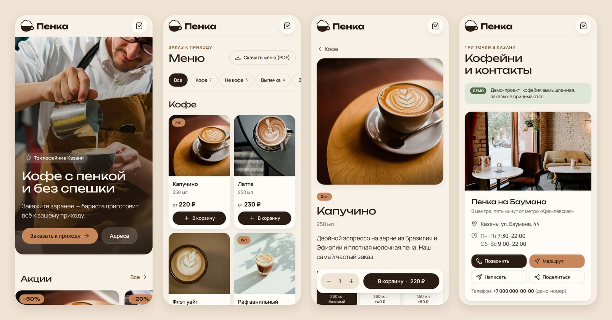

# «Пенка» — демо-сайт кофейни

Сайт вымышленной сети из трёх кофеен. Сделан для портфолио и как основа мобильного приложения:
приложение открывает его в WebView, поэтому здесь есть всё, что приложение умеет показать —
вход с сохранением сессии, корзина, форма с загрузкой фото, страницы акций для пушей, звонок,
карты, мессенджеры и скачивание PDF.

> **Демо-проект:** кофейня вымышленная, заказы не принимаются. Телефоны фиктивные, данные не покидают браузер.

**Сайт:** https://pymeepo.github.io/penka/



## Стек

- [Astro 7](https://docs.astro.build) — статическая сборка, TypeScript strict
- Tailwind CSS 4 через `@tailwindcss/vite`
- Интерактив — чистый TypeScript в `<script>` компонентов, без React/Vue
- Шрифты Manrope и Unbounded из `@fontsource`, локально; иконки — inline SVG из lucide
- Картинки — `<Image>`/`<Picture>` из `astro:assets` (avif/webp)
- PDF-меню — `pdf-lib`, собирается из тех же данных при каждой сборке
- Тесты — Playwright, качество — Lighthouse
- Хостинг — GitHub Pages через GitHub Actions

## Запуск

Нужен Node 22.23.4 или новее (в проекте — 26 LTS, см. `.nvmrc`).

```bash
npm install
npm run dev        # http://localhost:4321/penka/
npm run build      # PDF-меню → astro check → dist/
npm run preview    # собранный сайт
npm test           # Playwright (сначала npm run build)
npm run lighthouse # Lighthouse mobile, отчёты в .lighthouse/
npm run assets     # логотип, иконки, OG-картинка, заглушки для недостающих фото
```

Для тестов один раз: `npx playwright install chromium`.

## Как менять меню и акции

Все данные — в `src/data/`. Страницы, PDF-меню и `app-config.json` пересобираются из них сами.

**Позиция меню** — `src/data/menu.ts`, массив `menu`:

```ts
{
  slug: 'lavender-raf',           // адрес: /menu/lavender-raf/
  name: 'Лавандовый раф',
  description: 'Эспрессо, сливки и лавандовый сироп.',
  category: 'coffee',             // coffee | not-coffee | bakery | breakfast
  portion: '250 мл',
  price: 310,                     // ₽, для напитков — цена размера S
  image: 'raf',                   // ключ фото, см. ниже
  tags: ['new'],                  // 'hit' — «Хит», 'new' — «Новинка»; первые 4 хита идут на главную
  options: { sizes: true, milk: true, syrup: true }, // что выбирается на странице позиции
},
```

Доплаты за размер, молоко и сироп — там же: `sizeOptions`, `milkOptions`, `syrupOptions`.

**Акция** — `src/data/promos.ts`. Каждая получает страницу `/promo/<slug>/`:

```ts
{
  slug: 'lavender-week',
  title: 'Неделя лаванды',
  lead: 'Лавандовый раф со скидкой 20%.',  // эту строку удобно брать в текст пуша
  badge: '−20%',
  conditions: ['Скидка 20% на лавандовый раф.', 'Во всех трёх кофейнях.'],
  validFrom: '2026-12-01',
  validTo: '2026-12-14',                  // «Осталось N дней» считается в браузере
  image: 'raf',
  itemSlug: 'lavender-raf',               // кнопка «Заказать» ведёт на эту позицию
},
```

**Кофейни** — `src/data/locations.ts`, **вакансии** — `src/data/jobs.ts`.

**Фото.** Положите JPG в `src/assets/images/` (лучше от 1600 px, напиток в центре кадра),
добавьте имя файла без расширения в `src/data/images.ts` и укажите его в поле `image`.
Без фото сборка упадёт с понятной ошибкой; `npm run assets` создаст для недостающих файлов заглушки.

## Адреса страниц для приложения

Всё ниже собирается в **`/app-config.json`** — приложению достаточно скачать его при запуске:
https://pymeepo.github.io/penka/app-config.json

**Вкладки**

| Вкладка | Адрес |
|---|---|
| Главная | `https://pymeepo.github.io/penka/` |
| Меню | `https://pymeepo.github.io/penka/menu/` |
| Акции | `https://pymeepo.github.io/penka/promo/` |
| Кофейни | `https://pymeepo.github.io/penka/contacts/` |
| Профиль | `https://pymeepo.github.io/penka/account/` |
| Корзина (кнопка с бейджем) | `https://pymeepo.github.io/penka/cart/` |

**Акции для пушей** — `https://pymeepo.github.io/penka/promo/<slug>/`

| Пуш | Адрес |
|---|---|
| Второй капучино за полцены | `https://pymeepo.github.io/penka/promo/second-cappuccino/` |
| Ранний завтрак −20% | `https://pymeepo.github.io/penka/promo/early-breakfast/` |
| Неделя матчи: сироп в подарок | `https://pymeepo.github.io/penka/promo/matcha-week/` |

Позиция меню тоже годится как цель пуша: `https://pymeepo.github.io/penka/menu/<slug>/`.

**Другие страницы, показывающие возможности приложения**

| Возможность | Адрес |
|---|---|
| Оформление заказа (форма, маска телефона) | `/order/` → `/order/success/?n=<номер>` |
| Вход по СМС-коду, cookie на 30 дней | `/account/` (подходит любой код из 4 цифр, например 1234) |
| Загрузка фото/PDF из галереи или камеры | `/jobs/` |
| Звонок, карты, Telegram, WhatsApp, «Поделиться» | `/contacts/` |
| Скачивание PDF | `/files/menu.pdf` |
| Политика конфиденциальности, удаление данных | `/privacy/` |

## Контракт с приложением (WebView)

- **Режим приложения** включается, если в user agent есть `PenkaApp` или у `<html>` есть класс `in-app`.
  Тогда скрыты шапка, подвал, нижние вкладки и баннер «Скачайте приложение», добавлены отступы
  `env(safe-area-inset-*)`. В браузере режим можно включить для демо: `?app=1` (выключить — `?app=0`).
- **Бейдж корзины.** Элемент `.cart-count` всегда есть в DOM, в нём число товаров (и `data-count`).
- **Сообщения.** Если есть `window.ReactNativeWebView`, при каждом изменении корзины (и при загрузке
  страницы) сайт отправляет `postMessage(JSON.stringify({ type: 'cart', count }))`.
- **Сессия** — cookie `penka_session`, `Max-Age=2592000` (30 дней), `Path=/`, `SameSite=Lax`.
  Чтобы вход пережил перезапуск, WebView должен сохранять cookie (на Android — `CookieManager`, flush).
- **Внешние ссылки** `tel:`, `mailto:`, `https://yandex.ru/maps`, `https://t.me/`, `https://wa.me/` приложение
  должно открывать системно — список есть в `app-config.json` → `externalUrlPrefixes`.
- **Файлы.** `<input type="file" accept="image/*,application/pdf">` на `/jobs/` — WebView должен разрешить
  выбор файла и камеру. PDF-меню скачивается по ссылке с атрибутом `download`.

## Деплой

1. Создайте на GitHub репозиторий `penka` и отправьте код в ветку `main`.
2. В репозитории: **Settings → Pages → Build and deployment → Source: GitHub Actions**.
3. Каждый push в `main` собирает и публикует сайт (`.github/workflows/deploy.yml`).
   Тесты Playwright гоняются отдельно (`.github/workflows/ci.yml`) и деплой не блокируют.

**Свой домен.** Поменяйте одну строку в `site.config.mjs`:

```js
export const SITE_URL = 'https://penka.example/';
```

и добавьте файл `public/CNAME` с доменом. `site` и `base` для Astro, ссылки, манифест, PDF и
`app-config.json` возьмут адрес оттуда.

## Структура

```
site.config.mjs        адрес сайта — одна строка
src/data/              меню, акции, кофейни, вакансии, ключи фото
src/pages/             страницы; app-config.json.ts, manifest.webmanifest.ts
src/components/        шапка, подвал, карточки, иконки
src/lib/               корзина, сессия, заказы, маска телефона, мост к приложению, url()
src/assets/            фото (оптимизируются при сборке) и логотип
scripts/               логотип и иконки, заглушки фото, PDF-меню, Lighthouse, превью для README
brand/                 icon-1024.png и logo-transparent-1024.png для иконки и заставки приложения
tests/                 Playwright: смоук всех страниц, режим приложения, заказ, вход, маска телефона
screenshots/           скриншоты из тестов (Pixel 7)
```

## Качество

Lighthouse, мобильный режим, 10 страниц: Performance 96–100, Accessibility, Best Practices и SEO — 100.
Playwright (33 теста): все страницы открываются без ошибок в консоли и без горизонтальной прокрутки,
проверены режим приложения, сообщение в `ReactNativeWebView`, заказ от корзины до успеха и cookie сессии.

## Фото

Фото флэт уайта, американо, рафа с халвой, какао, матча-тоника, миндального круассана, булочки
с кардамоном, сырников и трёх кофеен — с [Unsplash](https://unsplash.com/license), авторы: Tim Schmidbauer,
Nathan Dumlao, Kari Shea, Elena Leya, Nguyễn Hiệp, Kimia Kazemi, Scott Gummerson, Valeriya Avdeeva,
Angela Bailey, Keghan Crossland, Johan Mouchet. Остальные фото добавлены владельцем репозитория.
Логотип нарисован кодом (`scripts/lib/brand.ts`).
